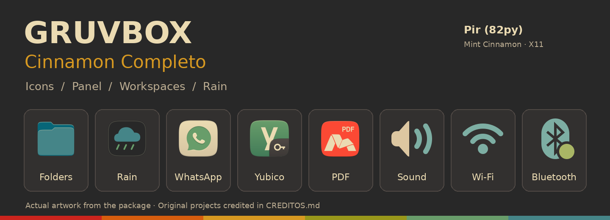
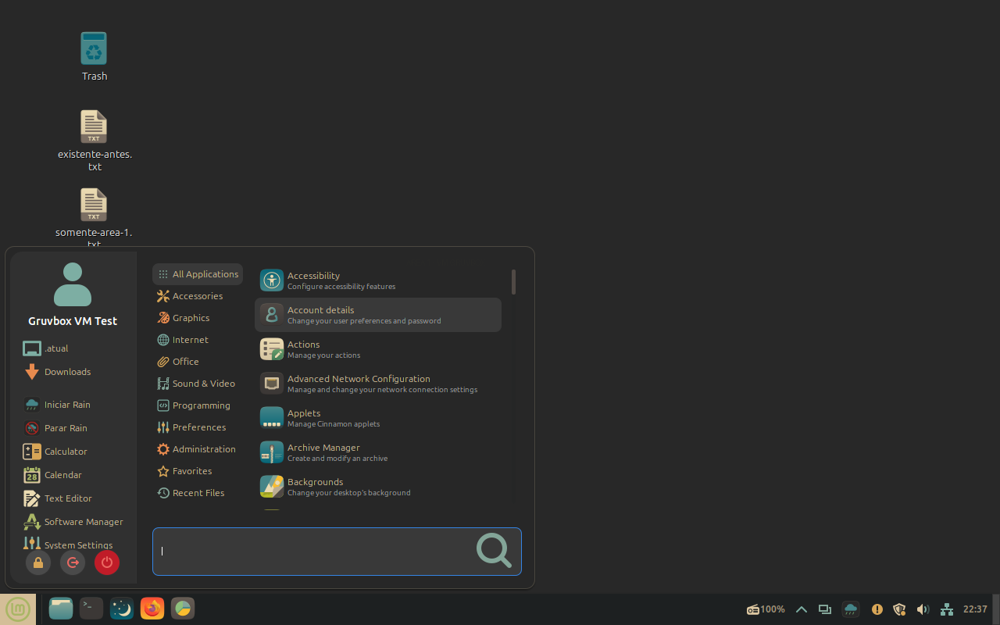
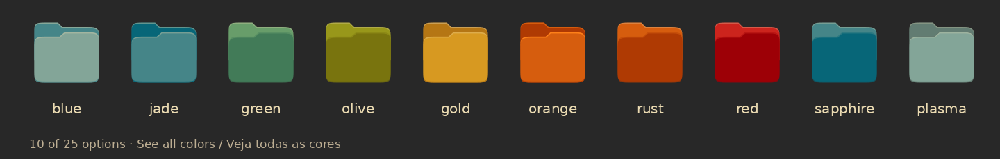

# Gruvbox Cinnamon Completo



[English](#english) · [Português](#português)

## English

A complete Gruvbox desktop setup for **Linux Mint Cinnamon**, with custom icons, a colorful panel, independent workspaces, and video wallpapers.

Created by **Pir ([82py](https://github.com/82py))**, with assistance from **OpenAI Codex**. Based on Gruvbox and the work of the authors credited in [CREDITOS.md](CREDITOS.md).

**Current release:** [1.0.3](https://github.com/82py/gruvbox-cinnamon-completo/releases/tag/v1.0.3) · **Target:** Linux Mint 22.3, Cinnamon/Nemo 6.6, X11.



[](docs/CORES-DAS-PASTAS.md)

*Actual Mint test VM above; artwork samples are rendered from the package SVGs. No personal wallpaper or profile photo is included.*

### What's included

- Customized Gruvbox Plus Dark application icons, colorful system icons, menu categories, and panel indicators.
- Desktop themes, cursor, panel and menu layout, Magic Lamp, Radio3, and custom extensions.
- **Rain:** video wallpapers with tray controls for playback, volume, and mute.
- Four workspaces with their own folders and backgrounds, plus a tool to copy files between them.
- A folder color picker, Nemo actions, the Relax fullscreen video launcher, an isolated terminal appearance profile, and font fixes for selected Flatpak apps.

**Personal videos, wallpaper images, profile photos, and documents are not included.** The setup starts with a solid Gruvbox background; you choose your own media. Third-party applications are installed separately.

### Install

Download the **TAR.GZ** and its **SHA-256 checksum file** from [Releases](https://github.com/82py/gruvbox-cinnamon-completo/releases). Use the TAR.GZ rather than GitHub's automatic ZIP to preserve icon symlinks. Extract it and open a terminal in the extracted folder:

```sh
bash verificar.sh
bash instalar.sh
```

Run as your regular user, then log out and back in. The installer creates backups and does not modify internal Cinnamon or application files. Dependencies are installed separately as described in the [installation guide](docs/INSTALAR.md).

To restore the previous setup:

```sh
bash desinstalar.sh
```

An existing managed installation must be uninstalled before installing another version. Read the [restoration guide](docs/DESINSTALAR.md) first. Detailed guides are currently in Portuguese: [workspaces and Rain](docs/ESPACOS-E-RAIN.md), [folder colors](docs/CORES-DAS-PASTAS.md).

### Compatibility and testing

This release targets **Cinnamon 6.6 on X11**. It is not an installer for Ubuntu GNOME or Wayland; see the [Ubuntu adaptation assessment](docs/UBUNTU.md).

- **1.0.3:** 22 automated tests passed, including GTK regression tests for repeated clicks in the file-copy dialog. Both final archives were also checked for folder colors and icon resolution.
- **1.0.2:** full installation, feature checks, uninstallation, and reboots were tested in a Linux Mint 22.3 QEMU/KVM VM. The final comparison found no differences in 115 installation destinations and 936 preferences; test documents were preserved.

The full VM cycle was not repeated for 1.0.3. See the [VM report](docs/VALIDACAO-VM.md), [copy-dialog tests](tests/test_copy_dialog.py), [coverage audit](docs/AUDITORIA-FINAL.md), and [GitHub Actions](https://github.com/82py/gruvbox-cinnamon-completo/actions).

### Source, credits, and licenses

`payload/` contains the portable desktop components; `scripts/` contains the installation and restoration tools; `tests/` contains the automated checks. The public installer builds xwinwrap from the source included in `vendor/xwinwrap/`.

The integration code is licensed under **GPL-3.0-or-later**. Third-party components retain their own licenses and attribution. See [credits](CREDITOS.md), [license notices](LICENSES/), [provenance](docs/PROVENIENCIA.json), and [contributing](CONTRIBUTING.md).

### Made with vibe coding

This project grew out of a personal desktop experiment, built through **vibe coding**. I brought the ideas, chose the look, and reviewed the results; OpenAI Codex helped turn that back-and-forth into icons, scripts, integrations, documentation, and a distributable package. The process included trying things in Cinnamon, refining them, and testing installation and restoration. The original projects and their authors remain credited throughout.

My thanks to the people whose code and artwork made this possible:

- **Pavel Pertsev (morhetz)** — the original [Gruvbox palette](https://github.com/morhetz/gruvbox).
- **SylEleuth** and contributors — [Gruvbox Plus Icon Pack](https://github.com/SylEleuth/gruvbox-plus-icon-pack).
- **Fausto-Korpsvart** and **Vince Liuice** — the [GTK theme](https://github.com/Fausto-Korpsvart/Gruvbox-GTK-Theme) used as the visual base.
- **Keefer Rourke** and **sainnhe** — Capitaine Cursors and its [Gruvbox variant](https://github.com/sainnhe/capitaine-cursors).
- **Clement Lefebvre** and the **Linux Mint contributors** — Cinnamon, Nemo, XApp, themes, and original system artwork.
- **klangman** and **hermes83** — [Magic Lamp](https://github.com/klangman/CinnamonMagicLamp) and its original extension base.
- **claudiux** and Cinnamon Spices contributors — [Radio3](https://cinnamon-spices.linuxmint.com/applets/view/360).
- **akarzim** — the original folder color chooser; **el-amine-404**, **claudiux**, and **anaximeno** — included Nemo actions.
- **David Reveman / Novell**, **Shantanu Goel**, **Aaahh**, and **mmhobi7** — the [xwinwrap code and forks](https://github.com/mmhobi7/xwinwrap).

The icon pack also builds on work by **Sam Hewitt**, **Andrea Bonanni**, **Gustavo Costa**, **Vince Liuice**, **Alexey Varfolomeev**, the **Papirus Development Team**, the **Numix Team**, **Keefer Rourke**, and **Adhe**. The MOD theme was traced to the **Twilight4** collection; this does not establish authorship of every historical CSS change. Full attribution, provenance details, and original license notices are in [CREDITOS.md](CREDITOS.md) and [LICENSES/](LICENSES/).


---

## Português

Uma personalização Gruvbox completa para o **Linux Mint Cinnamon**, com ícones próprios, painel colorido, espaços de trabalho independentes e fundos em vídeo.

Criada por **Pir ([82py](https://github.com/82py))**, com assistência do **OpenAI Codex**. Baseada no Gruvbox e no trabalho dos autores reconhecidos em [CREDITOS.md](CREDITOS.md).

**Versão atual:** [1.0.3](https://github.com/82py/gruvbox-cinnamon-completo/releases/tag/v1.0.3) · **Plataforma:** Linux Mint 22.3, Cinnamon/Nemo 6.6, X11.

### O que está incluído

- Ícones de aplicativos Gruvbox Plus Dark personalizados, ícones de sistema coloridos, categorias do menu e indicadores do painel.
- Temas visuais, cursor, organização do painel e dos menus, Magic Lamp, Radio3 e extensões próprias.
- **Rain:** fundos em vídeo com controles de reprodução, volume e som na bandeja.
- Quatro espaços com pastas e fundos próprios, além de uma ferramenta para copiar arquivos entre eles.
- Seletor de cores das pastas, ações do Nemo, atalho Relax para vídeo em tela cheia, perfil visual isolado do terminal e correções de fontes para determinados aplicativos Flatpak.

**Vídeos, imagens de fundo, foto de perfil e documentos pessoais não acompanham o pacote.** A configuração começa com um fundo sólido Gruvbox; cada pessoa escolhe suas mídias. Aplicativos de terceiros são instalados separadamente.

### Instalação

Baixe o **TAR.GZ** e seu **arquivo de verificação SHA-256** em [Releases](https://github.com/82py/gruvbox-cinnamon-completo/releases). Prefira o TAR.GZ ao ZIP automático do GitHub para preservar os links dos ícones. Extraia e abra um terminal na pasta extraída:

```sh
bash verificar.sh
bash instalar.sh
```

Execute como usuário comum; depois, encerre a sessão e entre novamente. O instalador cria cópias de segurança e não modifica arquivos internos do Cinnamon ou dos aplicativos. As dependências são instaladas separadamente, conforme o [guia de instalação](docs/INSTALAR.md).

Para restaurar a configuração anterior:

```sh
bash desinstalar.sh
```

Uma instalação gerenciada anterior precisa ser desinstalada antes de instalar outra versão. Leia primeiro o [guia de restauração](docs/DESINSTALAR.md). Veja também os guias de [espaços e Rain](docs/ESPACOS-E-RAIN.md) e [cores das pastas](docs/CORES-DAS-PASTAS.md).

### Compatibilidade e testes

Esta versão foi preparada para **Cinnamon 6.6 em X11**. Não é um instalador para Ubuntu GNOME ou Wayland; veja a [análise de adaptação para Ubuntu](docs/UBUNTU.md).

- **1.0.3:** 22 testes automatizados aprovados, incluindo testes GTK contra cliques repetidos na janela de cópia. Os dois compactados finais também foram verificados quanto às cores das pastas e à resolução dos ícones.
- **1.0.2:** instalação completa, recursos, desinstalação e reinicializações testados em uma VM QEMU/KVM com Linux Mint 22.3. A comparação final não encontrou diferenças em 115 destinos de instalação e 936 preferências; os documentos de teste foram preservados.

O ciclo completo de VM não foi repetido para a 1.0.3. Consulte o [relatório da VM](docs/VALIDACAO-VM.md), os [testes da janela de cópia](tests/test_copy_dialog.py), a [auditoria de cobertura](docs/AUDITORIA-FINAL.md) e o [GitHub Actions](https://github.com/82py/gruvbox-cinnamon-completo/actions).

### Código, créditos e licenças

`payload/` reúne os componentes portáteis; `scripts/`, as ferramentas de instalação e restauração; `tests/`, as verificações automatizadas. O instalador público compila o xwinwrap a partir do código incluído em `vendor/xwinwrap/`.

O código de integração usa **GPL-3.0-or-later**. Componentes de terceiros mantêm suas próprias licenças e atribuições. Consulte os [créditos](CREDITOS.md), [avisos de licença](LICENSES/), [registro de origem](docs/PROVENIENCIA.json) e [orientações para contribuir](CONTRIBUTING.md).

### Feito com vibe coding

Este projeto nasceu da vontade de deixar meu desktop com a minha cara e foi construído com **vibe coding**. Eu trouxe as ideias, escolhi a aparência e revisei os resultados; o OpenAI Codex ajudou a transformar essa conversa em ícones, scripts, integrações, documentação e um pacote compartilhável. O processo teve experimentação no Cinnamon, ajustes e testes de instalação e restauração. Os projetos que serviram de base e seus autores continuam reconhecidos nos créditos.

Meu agradecimento às pessoas cujo código e desenhos tornaram isso possível:

- **Pavel Pertsev (morhetz)** — a [paleta Gruvbox original](https://github.com/morhetz/gruvbox).
- **SylEleuth** e colaboradores — [Gruvbox Plus Icon Pack](https://github.com/SylEleuth/gruvbox-plus-icon-pack).
- **Fausto-Korpsvart** e **Vince Liuice** — o [tema GTK](https://github.com/Fausto-Korpsvart/Gruvbox-GTK-Theme) usado como base visual.
- **Keefer Rourke** e **sainnhe** — Capitaine Cursors e sua [variante Gruvbox](https://github.com/sainnhe/capitaine-cursors).
- **Clement Lefebvre** e os **colaboradores do Linux Mint** — Cinnamon, Nemo, XApp, temas e desenhos originais do sistema.
- **klangman** e **hermes83** — [Magic Lamp](https://github.com/klangman/CinnamonMagicLamp) e a extensão que lhe serviu de base.
- **claudiux** e colaboradores do Cinnamon Spices — [Radio3](https://cinnamon-spices.linuxmint.com/applets/view/360).
- **akarzim** — seletor original de cores das pastas; **el-amine-404**, **claudiux** e **anaximeno** — ações do Nemo incluídas.
- **David Reveman / Novell**, **Shantanu Goel**, **Aaahh** e **mmhobi7** — o [código e as variantes do xwinwrap](https://github.com/mmhobi7/xwinwrap).

O pacote de ícones também se apoia no trabalho de **Sam Hewitt**, **Andrea Bonanni**, **Gustavo Costa**, **Vince Liuice**, **Alexey Varfolomeev**, **Papirus Development Team**, **Numix Team**, **Keefer Rourke** e **Adhe**. A variante MOD do tema foi localizada na coleção de **Twilight4**; isso não identifica a autoria de cada alteração histórica do CSS. Os créditos completos, os detalhes de origem e os avisos de licença estão em [CREDITOS.md](CREDITOS.md) e [LICENSES/](LICENSES/).
