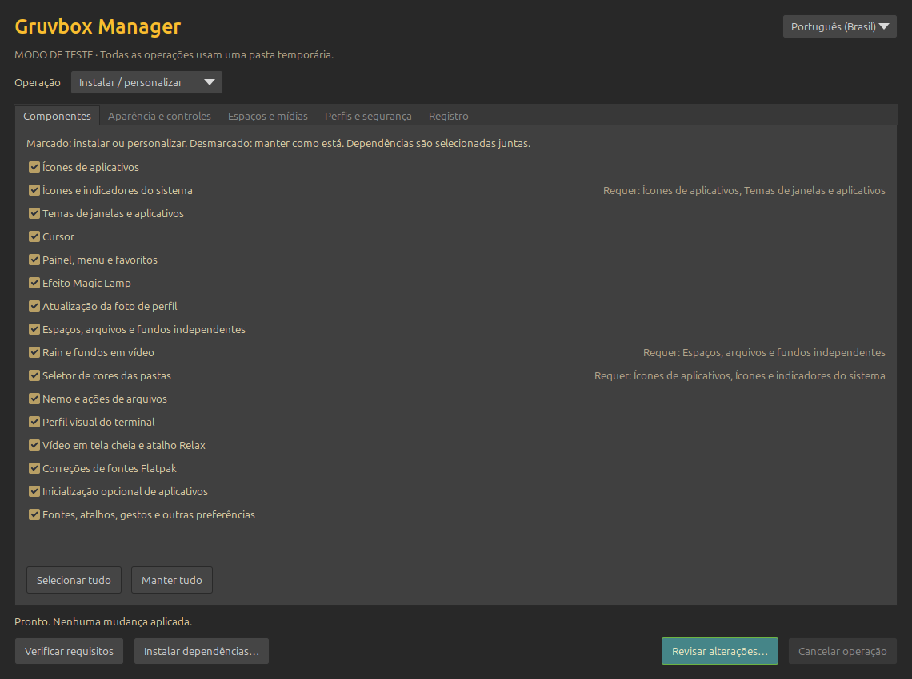
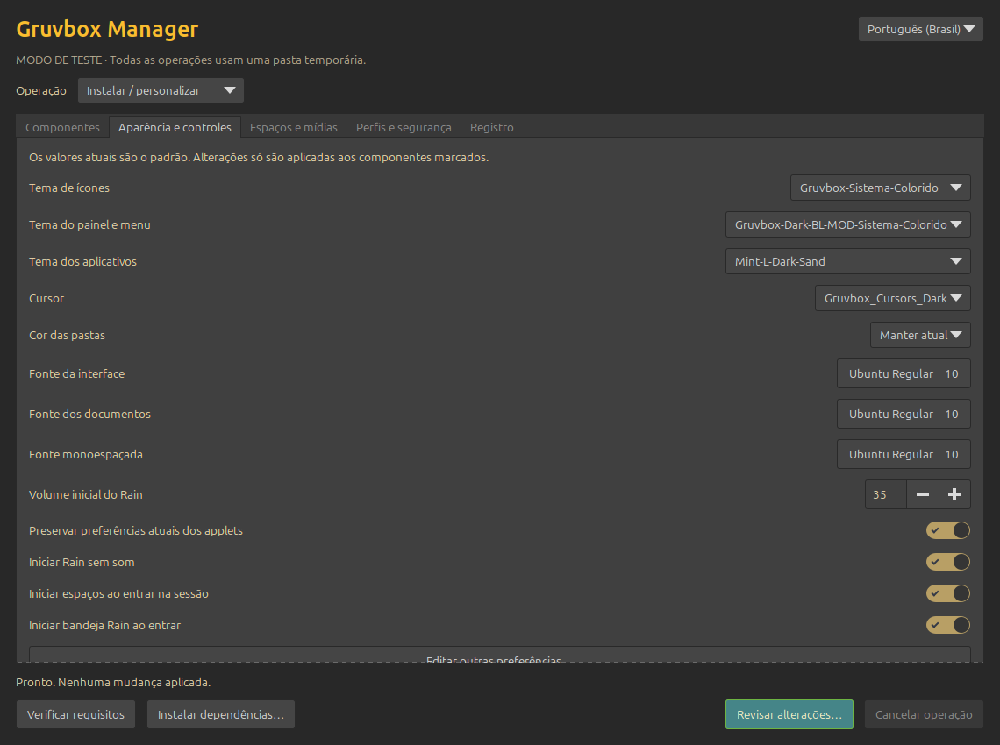
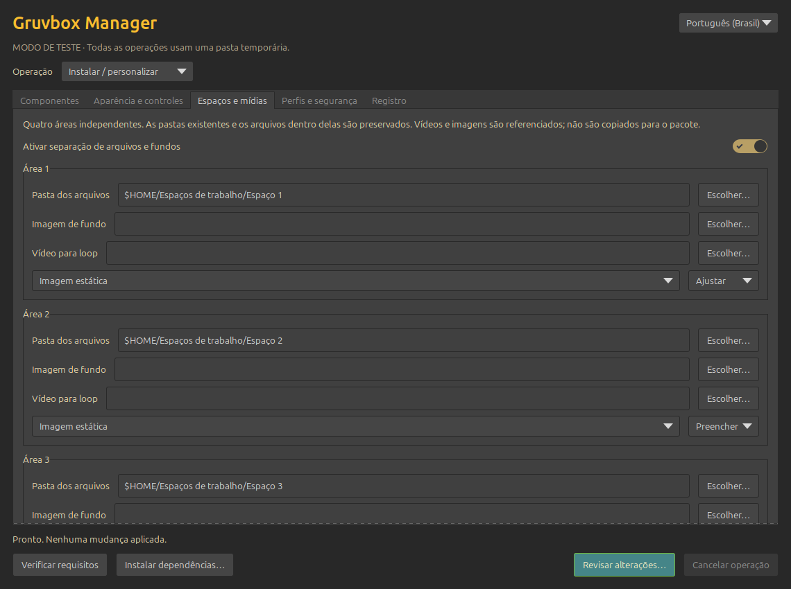

# Gruvbox Manager · Personal GUI

[English](#english) · [Português](#português)

## English

A local, personal GTK manager for the Gruvbox Cinnamon customization by **Pir (82py)**. GUI version **0.1.0-personal**, based on theme **1.0.3**. This GUI has not been published on GitHub.

### Open

Extract the entire archive and run `iniciar-gui.sh` as your regular user. Opening the window does not install anything. Python 3, PyGObject and GTK 3 must already be available (included in the tested Mint installation). Choose English in the top right corner if desired.

1. Choose **Install / customize**, **Uninstall components**, or **Restore a previous point**.
2. Select components. On installation, unchecked components stay unchanged. On removal and restoration, checked components are the ones being changed; only managed components can be uninstalled.
3. Customize appearance, folder colors, fonts, Rain volume/mute, autostart and the four workspace folders, images and videos.
4. Review requirements and changes. Installation starts only after the final confirmation.
5. Log out and back in after changing desktop components so all processes load the new configuration.

There are **16 components**: application icons, system indicators, themes, cursor, panel/menu, Magic Lamp, profile-photo refresh, independent workspaces, Rain, folder colors, Nemo, terminal appearance, Relax shortcut, Flatpak fonts, optional application autostart and other preferences. **Radio3 is excluded**: the manager neither installs nor configures it; an existing panel instance is preserved.

Current settings and workspace paths are read as defaults. The package layout button supplies the theme preset while keeping your media and folders. Dependencies are selected together; imported legacy workspaces that share Rain scripts are kept together. Fonts and selected preference values can be edited, and profiles can be exported/imported.

### Restore and personal data

Every operation creates a dated restore point before changing managed targets. Uninstall returns selected components to their state **before this manager first changed them**, which may already be customized; it does not mean factory Mint. Restore points can undo individual later operations. Failures attempt automatic rollback; an interrupted operation can be recovered from the safety tab on the next launch. Keep restore points until you are satisfied.

Documents in workspace folders, downloaded videos, background images and your profile photo are not included in the archive and are not deleted by uninstall. Created workspace folders remain. Removing Rain while retaining portable workspaces switches video backgrounds to static and retains video paths. The manager and its recovery history remain after component removal so you can restore them later.

By default the manager retains an offline copy of this installer under `~/.local/state/gruvbox-manager/installer`, along with its registry and private backups. Installed launchers use that copy, so the extracted source folder can be removed. If you disable retention, keep the source at its original location. Exported profiles contain local paths and preferences: treat them and restore points as private.

This manager does not adopt the old command-line installer's journal. If one exists, restore that installation using its original uninstaller first. Existing manual customization is backed up normally. Administrative authentication is requested only if you explicitly choose dependency installation. Optional applications are not bundled.

### Scope and validation

Tested environment: Linux Mint 22.3, Cinnamon/Nemo 6.6.x, X11, systemd user session, four workspaces. Other environments have not been validated. See [GUI validation](VALIDACAO-GUI.json) for tests of this version. [Original theme documentation](README-TEMA.md) describes the base release and may mention its older command-line workflow and Radio3; this page is the guide for the GUI variant.

No wallpaper images, videos, personal photo, private keys or saved personal profiles are distributed. Media must be supplied by the user. The stable published theme remains separate.

### Credits, vibe coding and disclaimer

Created by **Pir (82py)** with **OpenAI Codex**, using vibe coding. Built on work by **morhetz** (Gruvbox), **SylEleuth** (Gruvbox Plus), and the authors of the included desktop themes, cursor and components. Full authorship and license notices remain in [credits](CREDITOS.md), [LICENSE](LICENSE) and [third-party licenses](LICENSES). Radio3 authors remain acknowledged in the base project's history; Radio3 itself is excluded here.

Provided **“as is”**, without warranty of any kind, express or implied. To the extent permitted by applicable law, the authors and contributors are not liable for damages arising from use. Install and use at your own risk; keep an independent backup of personal files. Third-party components retain their respective licenses.

## Português

Gerenciador GTK local e pessoal para a personalização Gruvbox Cinnamon de **Pir (82py)**. Versão GUI **0.1.0-personal**, baseada no tema **1.0.3**. Esta GUI ainda não foi publicada no GitHub.

### Abrir

Extraia o arquivo inteiro e execute `iniciar-gui.sh` como usuário comum. Abrir a janela não instala nada. Python 3, PyGObject e GTK 3 precisam estar disponíveis (já presentes no Mint testado). A interface inicia em português e permite mudar para inglês no canto superior direito.

1. Escolha **Instalar / personalizar**, **Desinstalar componentes** ou **Restaurar ponto anterior**.
2. Selecione os componentes. Na instalação, desmarcado significa manter como está. Na remoção e restauração, os marcados serão alterados; só é possível desinstalar componentes gerenciados.
3. Personalize aparência, cores de pastas, fontes, volume/mudo do Rain, inicialização e as quatro pastas, imagens e vídeos dos espaços.
4. Confira requisitos e alterações. A instalação começa somente após a confirmação final.
5. Saia da sessão e entre novamente depois de mudar componentes do desktop para que todos os processos carreguem a nova configuração.

São **16 componentes**: ícones de aplicativos, indicadores do sistema, temas, cursor, painel/menu, Magic Lamp, atualização da foto, espaços independentes, Rain, cores de pastas, Nemo, visual do terminal, atalho Relax, fontes Flatpak, inicialização opcional e outras preferências. **Radio3 foi excluído**: o gerenciador não o instala nem configura; uma instância já existente no painel é preservada.

As configurações e caminhos atuais dos espaços são lidos como padrão. O botão de visual do pacote oferece o preset do tema mantendo suas mídias e pastas. Dependências são selecionadas juntas; espaços antigos que compartilham scripts com o Rain permanecem juntos. É possível editar fontes e preferências selecionadas, além de exportar/importar perfis.

### Restauração e dados pessoais

Cada operação cria um ponto datado antes de alterar arquivos e preferências gerenciados. Desinstalar retorna os componentes selecionados ao estado **anterior à primeira alteração por este gerenciador**, que pode já ser personalizado; não significa o padrão de fábrica do Mint. Pontos permitem desfazer operações posteriores individualmente. Falhas tentam reversão automática; uma operação interrompida pode ser recuperada na aba de segurança na próxima abertura. Guarde os pontos até estar satisfeito.

Documentos dos espaços, vídeos baixados, imagens de fundo e foto pessoal não entram no pacote e não são apagados pela desinstalação. Pastas criadas permanecem. Remover o Rain mantendo espaços portáveis troca fundos em vídeo por estáticos e conserva os caminhos dos vídeos. O gerenciador e o histórico permanecem após remover componentes para permitir recuperá-los.

Por padrão, uma cópia do instalador fica em `~/.local/state/gruvbox-manager/installer`, junto do registro e dos backups privados. Os atalhos instalados usam essa cópia, permitindo remover a pasta extraída. Se desativar essa retenção, mantenha a origem no mesmo local. Perfis exportados contêm caminhos locais e preferências: trate-os e os pontos de restauração como privados.

O gerenciador não assume o registro do antigo instalador de terminal. Se ele existir, restaure aquela instalação pelo desinstalador original primeiro. Personalizações manuais existentes são copiadas normalmente para backup. A autenticação administrativa aparece apenas se você escolher instalar dependências. Aplicativos opcionais não são incluídos.

### Escopo e validação

Ambiente testado: Linux Mint 22.3, Cinnamon/Nemo 6.6.x, X11, sessão systemd do usuário e quatro espaços. Outros ambientes não foram validados. Consulte a [validação da GUI](VALIDACAO-GUI.json). A [documentação original do tema](README-TEMA.md) descreve a versão base e pode mencionar o fluxo antigo de terminal e o Radio3; esta página orienta o uso da variante GUI.

O pacote não contém imagens de fundo, vídeos, foto pessoal, chaves privadas ou perfis pessoais salvos. As mídias são fornecidas pelo usuário. O tema estável já publicado continua separado.

### Créditos, vibe coding e aviso de responsabilidade

Criado por **Pir (82py)** com **OpenAI Codex**, usando vibe coding. Baseado no trabalho de **morhetz** (Gruvbox), **SylEleuth** (Gruvbox Plus) e dos autores dos temas, cursor e componentes incluídos. A autoria completa e as licenças permanecem nos [créditos](CREDITOS.md), na [licença](LICENSE) e nas [licenças de terceiros](LICENSES). Os autores do Radio3 continuam reconhecidos no histórico do projeto base; o Radio3 foi excluído desta variante.

Fornecido **“no estado em que se encontra” (“as is”)**, sem garantias expressas ou implícitas. Na extensão permitida pela legislação aplicável, os autores e colaboradores não respondem por danos decorrentes do uso. Instale e use por sua conta e risco; mantenha uma cópia independente dos arquivos pessoais. Componentes de terceiros mantêm suas respectivas licenças.
