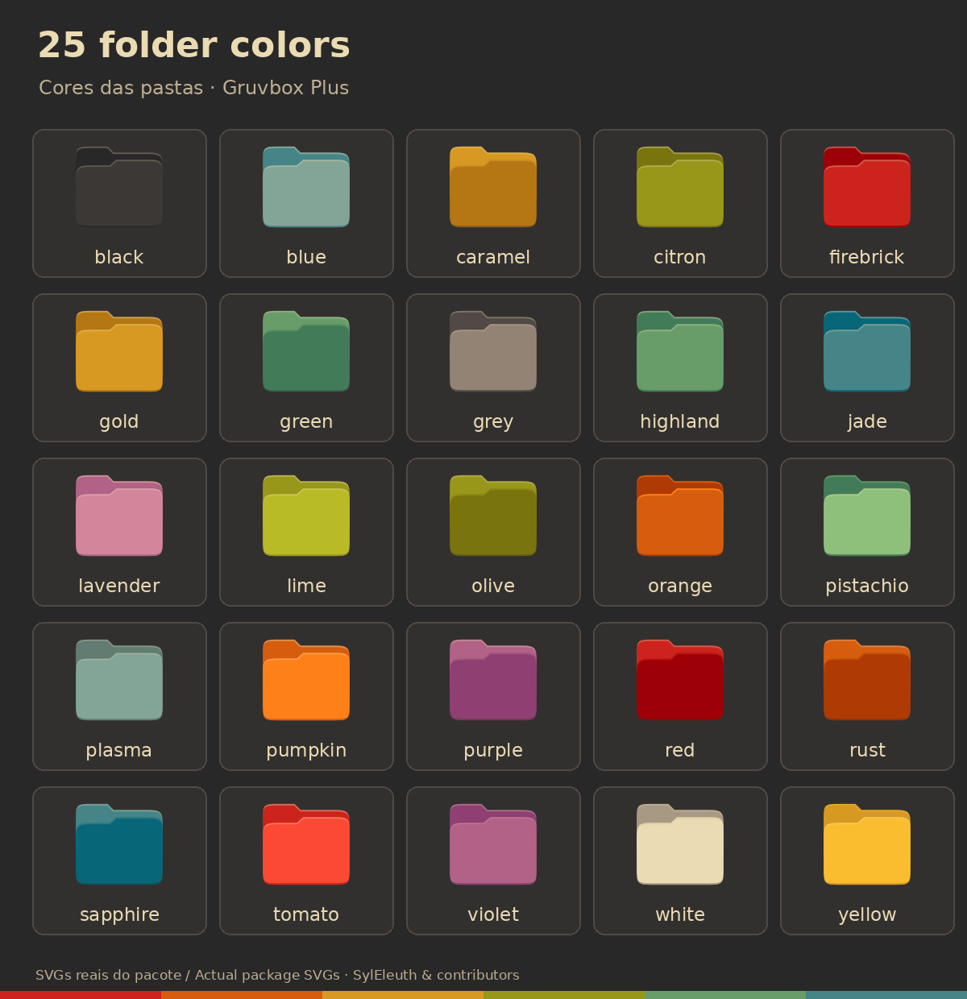

# Cor das pastas

A imagem acima mostra os SVGs reais distribuídos no pacote. Os nomes em inglês correspondem às opções do seletor e do comando `--color`; `plasma` é o padrão original. [Abrir a imagem em tamanho completo](imagens/folder-colors.png).

Depois de instalar o pacote, abra “Escolher cor das pastas Gruvbox” no Iniciar ou execute `bash "$HOME/escolher-cor-pastas.sh"`. Os dois arquivos SH também acompanham a raiz do pacote. Antes da instalação, a listagem e a ajuda funcionam, mas uma troca é recusada: isso impede alterações acidentais no tema do computador de montagem.

Há 25 cores, opção 0 para o padrão upstream plasma e opção r para restaurar a aparência anterior ao uso do seletor. O comando equivalente é `bash "$HOME/folders-color-chooser.sh" -c blue`; `-C` seleciona plasma e `--restore` devolve a aparência anterior.

O seletor original trocava links no tema Gruvbox Plus. A versão integrada cria as pastas em duas variantes próprias, A/B, e alterna entre elas para atualizar o cache de ícones. Os temas Gruvbox-Plus-Dark e Gruvbox-Sistema-Colorido ficam intactos. Os demais ícones são herdados do tema de sistema aprovado; ícones simbólicos `xsi-*` de ações do sistema mantêm suas cores específicas. A troca não modifica categorias, aplicativos, áudio, rede, Bluetooth, cursores, temas visuais, papéis de parede ou arquivos dos espaços.

A troca é recusada se outro tema estiver selecionado, se faltar o pacote instalado, se as variantes próprias tiverem sido substituídas, se a origem apontar para fora do tema ou se houver outra troca em andamento. O tema é montado antes da aplicação e as duas preferências de ícones são restauradas se a aplicação falhar. Não requer sudo nem reiniciar Nemo ou Cinnamon.

As variantes são registradas pelo instalador e pelo restaurador do pacote. Na desinstalação, as preferências anteriores são restauradas e as cópias modificadas são preservadas na pasta de recuperação já documentada. A opção r é a forma rápida de desfazer somente a escolha de cor.
